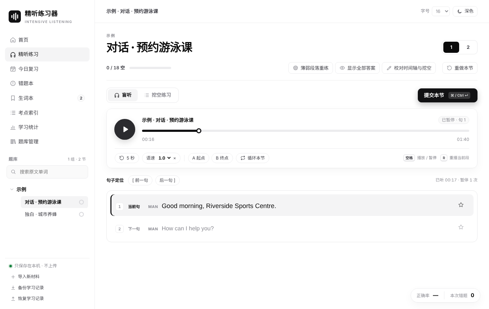
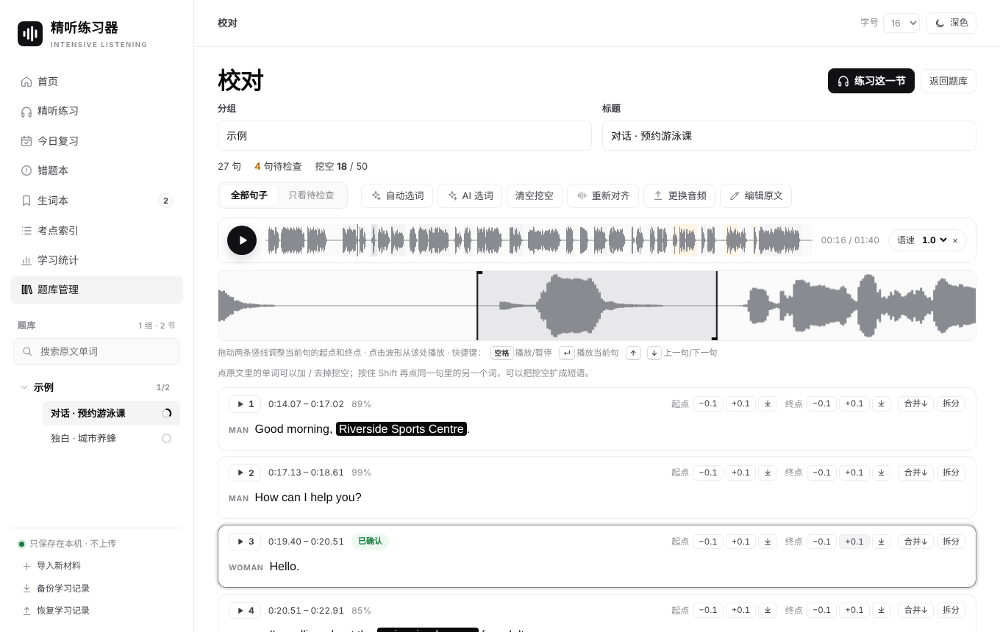
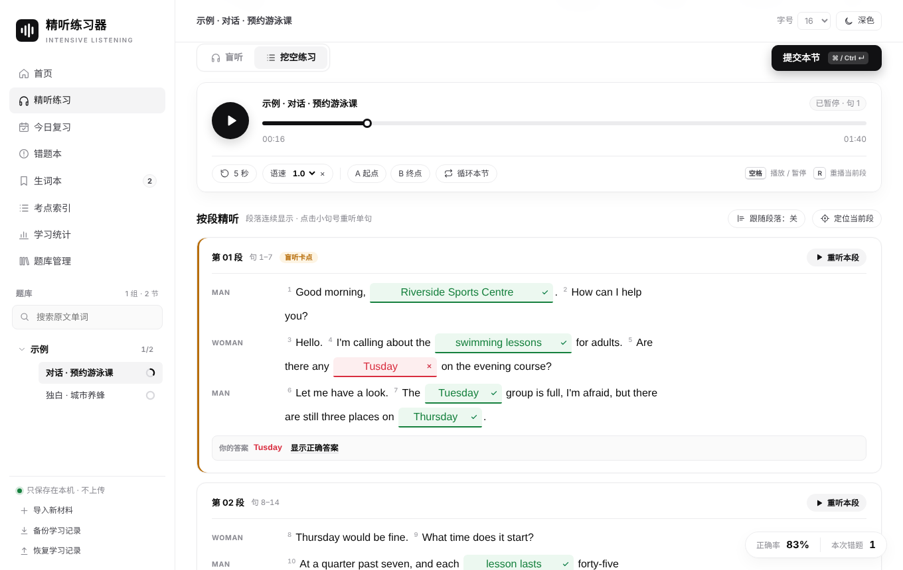

# 精听练习器 · Intensive Listening Trainer

把**你自己的**英语听力音频和原文放进浏览器，自动逐句对齐，然后做盲听和挖空听写。
所有处理都在你的浏览器里完成：音频、原文和学习记录只保存在本机，不会上传到任何服务器。

> 本项目只提供练习框架，**不附带任何受版权保护的听力材料**。请只导入你有权使用的音频和文本
> （自己购买的教材、自己录制的音频、公有领域材料等）。本项目与 IELTS、Cambridge 等考试或出版机构没有任何关联。

| 盲听：暂停时才显示当前句 | 校对：波形上拖动句子边界、点词加挖空 |
|---|---|
|  |  |
| **挖空听写：自动判分** | **手机** |
|  |  |

截图里的内容是项目自带的原创示例（合成语音）。

## 能做什么

- **导入**：选一段音频（mp3 / m4a / wav），粘贴英文原文。对话里的 `MAN:`、`WOMAN:` 这类说话人会被识别，空行表示新段落。
- **没有原文也行**：选“只有音频，自动识别原文”，浏览器里会识别出带标点的原文、区分说话人，把数字写回 £35、10 a.m.、1985 这样的格式，
  并建议删掉考试说明和例题重播。先校对（可能听错的词会标出来），确认后再对齐。详见 [docs/transcription.md](docs/transcription.md)。
- **自动对齐**：浏览器里运行一个小型语音识别模型（约 46 MB，第一次使用时下载，之后离线可用），
  把原文逐句对到音频上。录音开头的考试说明、"Now turn to Part 2" 这类原文里没有的语音会被自动跳过。
- **校对**：置信度低的句子会标出来；可以试听、在波形上拖动起止点、合并/拆分句子、修改原文后重新对齐。
- **挖空**：自动选词（离线规则：短语、长词、低频词、拼写易错词、人名、数字），点单词即可增删挖空；
  也可以用你自己的 AI 服务（DeepSeek、通义千问、Kimi、OpenAI、Claude 等）来选词。每节最多 50 个。
- **练习**：盲听（播放时不显示原文，暂停或拖动进度条时才显示当前句和前后各一句）、按段挖空听写、
  自动判分（英美拼写、数字写法都算对）、拼写对比、错题本、间隔复习、生词本、考点索引、学习统计。
- **手机**：页面适配手机；可以在电脑上导入、导出为“内容包”（.zip），再在手机上导入。
  也可以“添加到主屏幕”，离线使用。

## 怎么用

### 方式一：GitHub Pages（推荐）

把仓库推到 GitHub 后，在仓库 **Settings → Pages** 里选择 *Deploy from a branch*，分支选 `main`、目录选 `/ (root)`。
几分钟后就可以通过 `https://<你的用户名>.github.io/<仓库名>/` 打开，电脑和手机都能用。

### 方式二：在自己电脑上运行

需要 Python 3（macOS 自带）。

- macOS：双击 `start-mac.command`（第一次可能要在“系统设置 → 隐私与安全性”里允许运行）。
- Windows：双击 `start-windows.bat`。
- 或者在项目目录里运行 `python3 -m http.server 8000`，然后打开 <http://localhost:8000>。

> 不能直接双击 `index.html`：浏览器不允许 `file://` 页面运行对齐程序和保存题库。

### 一节材料的流程

1. **题库管理 → 导入新材料**：填分组（例如“Book 1 · Test 1”）和标题（例如“Part 1”），选音频，粘贴原文。
2. **开始对齐**：一段 5 分钟的录音在电脑上大约需要 30–60 秒（手机上会慢一些）。
3. **校对**：先看“只看待检查”的句子。点句号试听，必要时拖动波形上的竖线，或用 ±0.1 秒按钮微调。
4. **练习**：先盲听，卡住就暂停看当前句；再做挖空听写，提交后看成绩卡和错题。

没有原文时，第 1 步选“只有音频，自动识别原文”：识别完先校对原文（标波浪线的词试听一下，改说话人名字，确认要删的说明），
再点“原文没问题，开始对齐”。第一次使用要下载约 160 MB 模型。

想先看看效果，可以在首页点 **加载示例**（两段原创的合成语音材料）。

## 原文格式

```text
MAN: Good morning, Riverside Sports Centre. How can I help you?
WOMAN: Hello. I'm calling about the swimming lessons for adults.

Today I'd like to look at urban beekeeping, which has become surprisingly popular ...
```

- 一行开头的 `名字:` 是说话人（全大写、`Speaker 1:`、`Jan:` 都可以）。没有说话人的段落按独白处理。
- 从 PDF 复制的原文带有硬换行也没关系，会自动接回去；`SECTION 1`、`Part 2` 这样单独一行的标题会被忽略。
- 数字、金额、缩写（`£62`、`07946 318 205`、`BBC`）不需要改写成单词。

## 对齐的原理和准确度

对齐用的是 NVIDIA NeMo 的 Conformer-CTC Small 英语模型（int8 量化的 ONNX 版本），
在浏览器里用 onnxruntime-web（WebAssembly）运行。整段原文和整段录音做一次 CTC 强制对齐（Viterbi），
句与句之间允许跳过原文里没有的语音；再根据音量把句子边界挪到真正的开口和收尾处。

在 8 段商业出版的英语考试听力录音（共 427 句，起止时间经过人工逐句复核；这些录音不随项目发布）上测试：
句子起点与人工时间轴的差距中位数约 0.12 秒，90% 的句子在 0.4 秒以内，没有整句错位（超过 1 秒的 4 处差异，逐一核对后都是人工时间轴把句前停顿算进了句子或标错了）。
详见 [docs/alignment.md](docs/alignment.md)。

## 数据和隐私

- 题库（音频、原文、时间轴、挖空）保存在浏览器的 IndexedDB 里；学习记录也在本机。
- 清理浏览器数据会把它们一起删掉。换设备或重装之前，请在“题库管理”里**导出内容包**，在侧栏里**备份学习记录**。
- 只有这几种情况会联网：第一次对齐时下载对齐模型、第一次自动识别时下载识别和说话人模型（都从你打开网站的同一个地址下载）；使用 AI 选词时，
  原文会从你的浏览器直接发给你自己填写的 AI 服务商。

## 给开发者

```bash
npm install            # 安装 onnxruntime-node（只用于测试和命令行工具）
npm test               # 单元测试 + 用示例录音测试对齐、识别和说话人区分
node tools/make-pack.js --out pack.zip --collection "Book 1" --title "Part 1" --audio p1.mp3 --text p1.txt
node tools/make-pack.js --out pack.zip --collection "Book 1" --title "Part 2" --audio p2.mp3 --auto   # 没有原文
```

- 网站本身没有构建步骤，全部是普通的 HTML / CSS / JavaScript。
- 目录：`app/`（页面和逻辑）、`app/align/`（特征提取、CTC 对齐、Web Worker）、`models/`（识别模型）、
  `vendor/ort/`（onnxruntime-web）、`data/`（常用词表）、`samples/`（示例）、`tests/`、`tools/`、`docs/`。
- 内容包格式见 [docs/content-pack.md](docs/content-pack.md)。

## 许可

- 代码：MIT，见 [LICENSE](LICENSE)。
- 第三方组件（对齐和识别模型 CC BY 4.0、说话人模型 Apache-2.0、onnxruntime-web MIT、词表 CC BY-SA 4.0、示例音频等）见
  [THIRD_PARTY_NOTICES.md](THIRD_PARTY_NOTICES.md)。

---

## English summary

A static web app for intensive listening practice with **your own** audio and transcripts (or audio only: it can
transcribe in the browser with NVIDIA Parakeet TDT-CTC 110M, tell speakers apart with a CAM++ voice model, rewrite
numbers the way exam transcripts print them, and suggest removing test instructions — then you proofread). Paste a transcript,
pick an audio file, and the browser aligns every sentence to the recording with a small CTC speech model
(NeMo Conformer-CTC Small, ONNX, run by onnxruntime-web). Untranscribed speech such as test instructions is
skipped automatically. Then practise with blind listening (text appears only when you pause), cloze dictation
with automatic grading, a mistake book with spaced review, and a vocabulary list. Nothing is uploaded: the
library lives in IndexedDB and can be moved between devices as a `.zip` content pack. No copyrighted material is
included; import only material you have the right to use. Not affiliated with IELTS or Cambridge.
Serve the folder over HTTP (GitHub Pages, or `python3 -m http.server`); `file://` is not supported.
